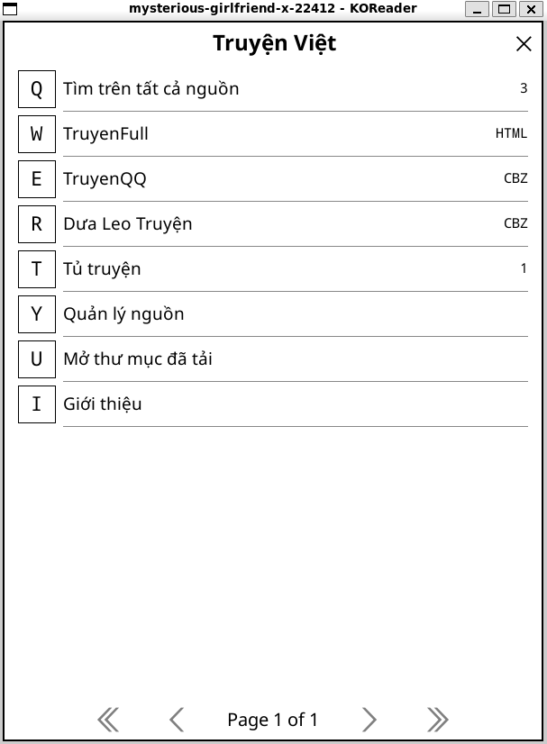
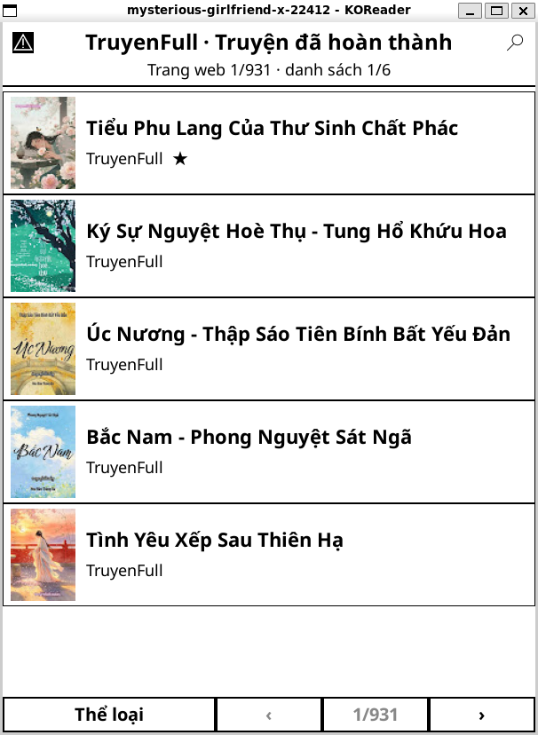
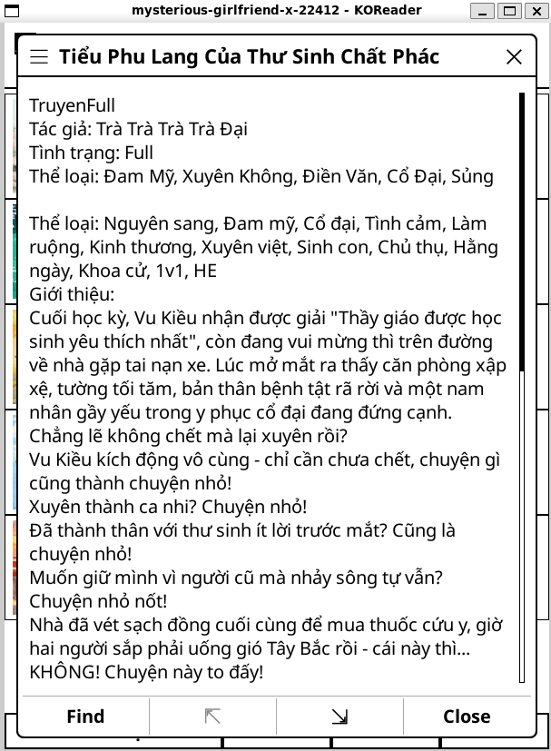
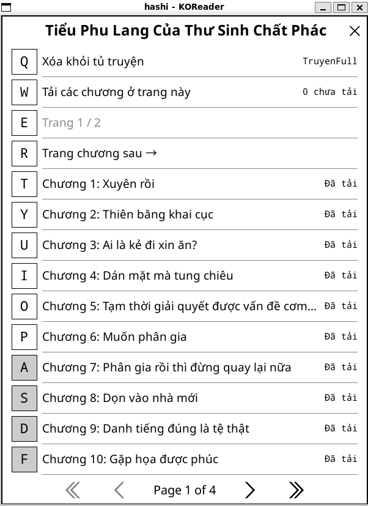
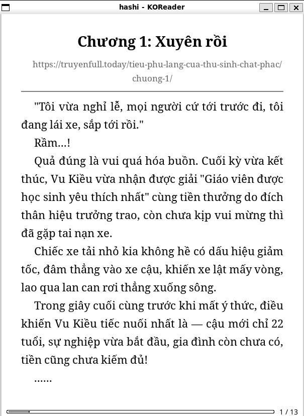

# Truyện Việt cho KOReader

Plugin KOReader thuần Lua để tìm, đọc và lưu truyện trực tuyến.

## Nguồn

- Truyện chữ: [TruyenFull](https://truyenfull.live), [TruyenDich](https://truyendich.us), DocLN,
  Mizzya, Mê Truyện VN, AzTruyen, DuaLeoTruyenFull, TruyenC và [XTruyện](https://xtruyen.vn).
- Truyện tranh: TruyenQQ, [Dưa Leo](https://dualeotruyenbg.com) và Hắc Ám Chi Các.
- Ebook (tệp gốc EPUB/PDF): Dilib Thư Viện Số.

> Trạng thái kiểm chứng từng nguồn:
> [docs/SOURCE_AUDIT_2026-10-22.md](docs/SOURCE_AUDIT_2026-10-22.md).

Plugin tải chương về thư mục dữ liệu KOReader rồi mở bằng trình đọc có sẵn:

- Truyện chữ: từng chương HTML, hoặc gom cả truyện thành **một HTML** hoặc **một EPUB 3**.
- Truyện tranh: đóng gói CBZ, phù hợp trình đọc manga của KOReader.
- Ebook: giữ nguyên tệp gốc sau khi kiểm tra đúng chữ ký EPUB/PDF.

## Tính năng

- Chạm vào từng nguồn để mở ngay danh sách truyện đã hoàn thành.
- Tìm riêng trong nguồn bằng nút kính lúp, lọc theo thể loại và chuyển trang ngay trên danh sách.
- Tìm đồng thời trên mọi nguồn đang bật hoặc tìm theo từng nguồn.
- Hiển thị ảnh bìa bên trái, tên truyện và nguồn bên phải; cache ảnh bìa, hỗ trợ **Tải lại ảnh bìa**.
- Bật/tắt nguồn, đổi tên miền nguồn (giữ tên nguồn trong **Quản lý nguồn**).
- Xem danh sách chương và phân trang.
- **Tải thành HTML** hoặc **Tải thành EPUB** (gom tất cả chương truyện chữ):
  có tiến trình, chạm vào khung tiến trình để dừng, báo lỗi theo chương, hỏi trước
  khi ghi đè. EPUB có bìa (nếu tải được), trang tiêu đề và mục lục.
- Tủ truyện, lịch sử đọc; **Xóa hết** kèm tùy chọn dọn file đã tải.
- Nút `Quay lại Truyện Việt` trong menu khi đang đọc chương.
- Gửi **Báo lỗi** trực tiếp từ thiết bị nếu có sự cố.
- Menu plugin và chương đã tải vẫn mở được khi offline.

## Ảnh chụp màn hình

| Trang chính | Danh sách truyện có ảnh bìa |
| :---: | :---: |
|  |  |

| Chi tiết và mô tả truyện | Mục lục và tải chương |
| :---: | :---: |
|  |  |

### Đọc truyện trong KOReader

<p align="center">
  
</p>

## Cài đặt

1. Tạo gói với `./scripts/build.ps1` (Windows) hoặc `./scripts/build.sh` (Linux/macOS),
   hoặc tải `truyenviet.koplugin.zip` từ trang phát hành.
2. Giải nén để nhận thư mục `truyenviet.koplugin` và chép nguyên thư mục vào `plugins` của KOReader.
3. Khởi động lại KOReader rồi mở **Truyện Việt** từ menu chính.

```text
Android: /sdcard/koreader/plugins/truyenviet.koplugin
Kindle:  /mnt/us/koreader/plugins/truyenviet.koplugin
Kobo:    /mnt/onboard/.adds/koreader/plugins/truyenviet.koplugin
Linux:   ~/.config/koreader/plugins/truyenviet.koplugin
```

Thư mục phải kết thúc bằng `.koplugin`; không chép riêng các file Lua ra ngoài.
Plugin chỉ dùng API đa nền tảng của KOReader, nên cùng một gói dùng được trên
Android, Kindle (đã jailbreak) và Kobo. Trên thiết bị ít RAM, nên tải từng trang
mục lục thay vì quá nhiều chương manga liên tiếp.

## Sử dụng

- Chạm vào nguồn để xem truyện đã hoàn thành; nút kính lúp để tìm; `Thể loại`, `‹`, `›` để lọc/chuyển trang.
- Chạm một truyện để mở danh sách chương; giữ tên truyện để xem mô tả hoặc thêm/xóa khỏi tủ truyện.
- Chạm một chương để tải và đọc; giữ tên chương để mở, tải lại hoặc xóa bản đã tải.
- `Tải các chương ở trang này` để tải hàng loạt chương chưa có.
- `Tải thành HTML` / `Tải thành EPUB` để gom cả truyện thành một tệp.
- Trong trình đọc, mở menu và chọn `Quay lại Truyện Việt`.

Chương manga có thể chứa hàng trăm ảnh; plugin ghi từng ảnh trực tiếp vào CBZ để hạn chế dùng RAM.

## Phát triển và kiểm thử

Quy ước kiến trúc, trách nhiệm từng module và tiêu chuẩn thay đổi:
[docs/DEVELOPMENT.md](docs/DEVELOPMENT.md).

Chạy toàn bộ test bằng LuaJIT của KOReader (WSL/Linux):

```sh
bash spec/run_all.sh --integration
```

### Chạy KOReader trên Windows qua WSL

KOReader không có bản Windows native chính thức; dùng WSL2/WSLg:

```sh
cd /tmp
wget https://github.com/koreader/koreader/releases/download/v2026.03/koreader_2026.03-1_amd64.deb
sudo apt install ./koreader_2026.03-1_amd64.deb
mkdir -p ~/.config/koreader/plugins
ln -sfnT /mnt/d/Project/truyenfull/truyenviet.koplugin ~/.config/koreader/plugins/truyenviet.koplugin
koreader
```

Sau mỗi lần sửa Lua, thoát và mở lại KOReader. Log: `~/.config/koreader/crash.log`.

### Cài bản thử lên Android

```powershell
adb push .\truyenviet.koplugin /sdcard/koreader/plugins/truyenviet.koplugin
```

### Checklist trên KOReader

1. Chạm lần lượt TruyenFull, TruyenQQ và Dưa Leo; mỗi nguồn phải mở danh sách truyện có bìa.
2. Trong từng nguồn, thử kính lúp, chọn thể loại và chuyển trang.
3. Tìm `phàm nhân` trên tất cả nguồn; kết quả khớp sát đứng trước.
4. Mở một chương chữ; HTML hiển thị tiếng Việt đúng.
5. Mở một chương manga ngắn, chờ tạo CBZ, lật trang kiểm tra thứ tự ảnh.
6. Trong mục lục truyện chữ, chọn `Tải thành EPUB`; chạm khung tiến trình → `Tiếp tục`;
   chờ xong → `Mở`. Kiểm tra bìa, mục lục, tiếng Việt.
7. Chạy lại `Tải thành EPUB` cho cùng truyện: phải hỏi ghi đè. Chạy lần nữa và chọn
   `Dừng` giữa chừng: không được còn tệp `.epub.part`.
8. `Tải thành HTML` cho một truyện ngắn và mở tệp kết quả.
9. Mở `Quay lại Truyện Việt` khi đang đọc.
10. `Quản lý nguồn`: DTV eBook hiển thị `Đã tắt · Cloudflare chặn`; bật DTV và mở → phải
    báo lỗi thân thiện, không crash, không tạo file.
11. Tắt/bật Dưa Leo từ trang chính và từ màn hình quản lý.
12. Gây lỗi rồi dùng `Chép log` trong hộp báo lỗi: không crash.
13. Tắt mạng; menu plugin và chương đã tải vẫn mở được.

## Lưu ý

Đây là trình đọc phía khách, không chứa nội dung truyện. Website nguồn có thể thay
đổi HTML, CDN hoặc chính sách chống bot. Plugin không vượt CAPTCHA, DRM hay cơ chế
giới hạn truy cập; nguồn trả Cloudflare/403 được coi là blocked cho đến khi có truy
cập hợp lệ. Người dùng tự chịu trách nhiệm tuân thủ điều khoản của website nguồn và
quyền tác giả tại nơi mình sinh sống.
